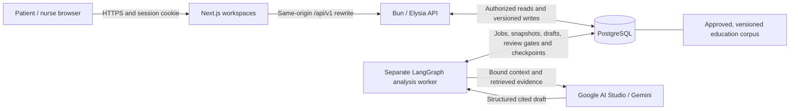

# ForCare

A web application for coordinating patient follow-up, daily check-ins, homecare visits, and nurse-reviewed care information.

## Team

**Team name:** fourgoat

| Registered member | Role |
|---|---|
| Ilham Shahputra Hasim | Frontend Developer |
| Muhammad Faza Al-Banna | Backend Developer |
| Jihan Andita Kresnaputri | UI/UX Engineer |
| Putri Hamidah Riyanto | UI/UX Engineer |

## Application, problem, and target users

- **Application:** ForCare
- **Category:** Web
- **Subtheme:** Inclusive Health & Well-being
- **Live application:** [forcare.trackover.web.id](https://forcare.trackover.web.id/)
- **Source code:** [Frsxk/ForCare](https://github.com/Frsxk/ForCare), containing both frontend and backend

**Problem addressed:** Patients receiving care at home need a structured way to report their condition, access care instructions, and request nursing visits. Nurses and care providers need to distinguish patient reports from confirmed observations, track scheduling decisions, and keep care information tied to the appropriate patient and responsible nurse.

**Solution:** ForCare connects patient check-ins, versioned care records, and homecare scheduling in one application. AI can prepare evidence-linked nursing drafts, but a responsible nurse reviews the content and explicitly publishes the patient-facing revision. Booking approval and clinical review remain separate human decisions.

**Target users:** patients and families supporting home care; nurses responsible for assigned patients or selected homecare visits; and hospitals/homecare providers coordinating those services. The implemented application has patient and nurse accounts, not a separate hospital-administrator or family-account role.

## Implemented features

| Area | Implemented functionality |
|---|---|
| Accounts and access | Cookie-backed sessions, patient registration, login/logout, provisioned nurse accounts, and patient/assignment-scoped access. |
| Patient workspace | Profile/contact editing; draft, correction, and explicit submission of daily check-ins; measurement history; active care guides; and published patient-facing analyses. |
| Nurse workspace | Assigned-patient directory, versioned medical snapshots and immutable corrections, recorded observations and separate nurse confirmations, patient-specific clinical sources, and care instructions. |
| Homecare requests | Active nurse directory, actual published availability slots, screening drafts, save/reopen, explicit consent and submission, request history, and cancellation before the visit starts. |
| Nurse scheduling | Nurse-managed versioned availability; selected-nurse acceptance/rejection; confirmed visit schedules; reasoned cancellation; and rescheduling with a reason and explicit patient agreement. |
| Manual availability exception | A separate nurse review can approve one exact outside-availability interval. That approval does not submit or accept the booking, bypass conflicts, or represent clinical priority scoring. |
| Reviewed AI drafts | Asynchronous cited drafts, revision and review, durable review pauses, and a separate explicit publication action. Requires the configured worker, approved corpus, and model access described below. |

An accepted booking creates a **scheduling-only visit identity**, not a completed clinical record. It does not reassign the primary nurse or grant full-chart access. A selected homecare nurse receives only the temporary request/visit context authorized for that booking; general chart access follows primary-assignment rules. Conflicts, immutable history, and exception rules are documented in the [API reference](backend/API.md#bookings-and-selected-nurse-scheduling).

**Not implemented:** numerical clinical scoring, clinical visit records/completion/finalization, notifications/reminders, and browser push. Retained mock-only frontend components are not the active product implementation. ForCare is not an emergency-response service and does not provide autonomous diagnosis or prescribing.

## Technology

| Layer | Technology and purpose |
|---|---|
| Frontend | Next.js 16.4.6 App Router, React 19.3.0, TypeScript, and Tailwind CSS 4.3.3. |
| UI resources | Lucide React icons; locally hosted Lato, Fredoka, and Plus Jakarta Sans fonts through Fontsource. |
| Backend | Bun 1.4.2, Elysia 1.4.32, TypeScript, and Zod 4.6.7 for request/schema validation. |
| Database | PostgreSQL 16 for domain records, sessions, audit/history, jobs, and approved knowledge retrieval. |
| AI workflow | LangChain 1.6.5, `@langchain/core` 1.4.0, LangGraph 1.7.4, and PostgreSQL checkpoints through `@langchain/langgraph-checkpoint-postgres` 1.1.3 and `pg` 8.23.1. |
| Model integration | `@langchain/openai` 1.8.4 calls Google AI Studio's OpenAI-compatible endpoint; this does not make OpenAI the clinical model provider. |
| Infrastructure | Docker and Docker Compose for the backend and PostgreSQL. Next.js and the analysis worker run separately. |

Exact dependency declarations and lockfiles are in [frontend/package.json](frontend/package.json), [frontend/package-lock.json](frontend/package-lock.json), [backend/package.json](backend/package.json), and [backend/bun.lock](backend/bun.lock). Google AI Studio is the external service used by the clinical draft feature; the independently configured connectivity CLI is described under AI use.

## System architecture and data flow



The API enforces access before reading or changing patient data. Check-ins and scheduling use the database directly and do not require AI. The worker reads a frozen input snapshot and approved educational material, saves a draft, and pauses for nurse review. Approval must be reconciled by the worker before a separate API publication action can expose the patient-facing projection.

### Structure

- `frontend/`: patient and nurse workspaces, session handling, and the same-origin API proxy.
- `backend/`: Elysia API, PostgreSQL migrations, operator scripts, tests, and the separate analysis worker.
- `backend/src/knowledge/`: fixed educational corpus, provenance, retrieval, and controlled importer.
- `compose.yaml`: backend API and PostgreSQL services only.
- `.env.example`: configuration variable names without real secret values.

## Installation, configuration, and running

### Prerequisites

- Git, Docker Engine, and Docker Compose v2 or later.
- Bun **1.4.2** for backend scripts, tests, and the worker; the Docker runtime is pinned to that version.
- Node.js **22 or later** and npm are recommended for the frontend; Next.js itself requires Node.js 20.9.0 or later.
- A Google AI Studio API key with access to the configured models **only when demonstrating AI draft generation**. Booking, check-ins, and scheduling do not require it.

```sh
git clone https://github.com/Frsxk/ForCare.git
cd ForCare
```

The shell examples below use POSIX syntax. The [backend setup guide](backend/README.md#reproducible-native-localhost-demo) also explains private environment-file usage and Windows operator commands.

### Environment variables

Start with [`.env.example`](.env.example). Keep actual `.env` files, API keys, database passwords, and session secrets out of Git. The root template is for Compose; a native environment requires the additional settings listed below.

| Variable | Purpose and requirement |
|---|---|
| `POSTGRES_PASSWORD` | Required database password; generate a unique private value. |
| `POSTGRES_DB` | Database name; Compose defaults to `forcare`. |
| `POSTGRES_USER` | Database user; Compose defaults to `forcare`. |
| `BACKEND_PORT` | Compose API host port; defaults to `3001`. Not the container listener port. |
| `AUTH_ALLOWED_ORIGINS` | Required comma-separated exact frontend origins, HTTPS in production; no wildcard. For the hosted demo, the origin is `https://forcare.trackover.web.id` without a trailing slash. |
| `AUTH_SESSION_SECRET` | Required random secret of at least 32 characters for session IP hashing and cursor signing. |
| `AUTH_NURSE_EMAIL_DOMAIN` | Exact approved nurse email domain; the synthetic demo uses `nurse.invalid`. Unset blocks nurse provisioning/login. |
| `AUTH_LOCAL_HTTP_TEST` | Defaults to false. Enable only for the native loopback HTTP procedure, never a normal public deployment. |
| `GOOGLE_API_KEY` | Required only by the separate clinical analysis worker; never expose it to the frontend. Compose does not pass this key. |
| `AI_ENABLED` | Defaults to false; enables only the independent non-medical `ai:smoke` CLI, not the clinical analysis worker. |
| `AI_API_KEY` | Provider credential for `ai:smoke` when enabled; separate from `GOOGLE_API_KEY`. |
| `AI_MODEL` | Model for `ai:smoke` when enabled; does not select the clinical worker's models. |
| `AI_BASE_URL` | Optional OpenAI-compatible endpoint for `ai:smoke`; blank uses OpenAI. Not the clinical worker's endpoint. |
| `AI_TIMEOUT_MS` | Optional model-call timeout; defaults to `30000` ms and is bounded at `120000` ms. |
| `HOST`, `PORT` | Native API/worker server settings. API defaults are `127.0.0.1:3001`; Compose supplies `0.0.0.0:3000` inside its container. |
| `DATABASE_HOST`, `DATABASE_PORT` | Native database connection settings; defaults are `db:5432`. The isolated native demo explicitly uses `127.0.0.1:55432`. |
| `FORCARE_BACKEND_ORIGIN` | Next.js server/build configuration; defaults to `http://127.0.0.1:3001`. Must be an HTTP(S) origin without credentials, path, query, or fragment. Not a browser-exposed secret. |

Optional blank Compose variables use the defaults in `compose.yaml`; a blank variable in a native environment file is not necessarily equivalent to an unset variable. Compose forces `LANGSMITH_TRACING=false` and `LANGCHAIN_TRACING_V2=false`.

### Run the backend and database

From the repository root, configure the private values before starting:

```sh
cp .env.example .env
# Set POSTGRES_PASSWORD and a 32+ character AUTH_SESSION_SECRET in .env.
# Set AUTH_ALLOWED_ORIGINS to the exact HTTPS frontend origin.
# Set AUTH_NURSE_EMAIL_DOMAIN=nurse.invalid for the synthetic nurses.
docker compose config --quiet
docker compose build backend
docker compose up -d --wait db
docker compose run --rm --no-deps backend bun run migrate
docker compose up -d --wait backend
curl --fail http://127.0.0.1:3001/health/ready
```

The API is published on `127.0.0.1:3001`; change `BACKEND_PORT` if needed. PostgreSQL is available to containers at `db:5432` and has **no published host port**. Run migrations before using account, availability, or booking routes. Migrations verify applied checksums and do not seed users or availability.

This Compose setup provides the API and database, **not a complete browser deployment**. Production authentication requires an HTTPS frontend and its exact allowed origin. Compose binds `HOST=0.0.0.0` inside the container and cannot use the native loopback-only HTTP mode.

For an end-to-end **localhost demo**, follow [Reproducible native localhost demo](backend/README.md#reproducible-native-localhost-demo): it uses a separate disposable PostgreSQL container, private environment configuration, native API, frontend, and optional worker. Use frontend `http://localhost:3000` and API `127.0.0.1:3001` consistently. If using port `3400`, allow `http://localhost:3400` exactly; `localhost` and `127.0.0.1` are different browser origins.

That local path is qualified for Chromium on localhost only. It does not weaken the `Secure`/`__Host-` session-cookie attributes or promise general HTTP compatibility.

```sh
docker compose ps
docker compose logs --tail 50 backend
docker compose down
```

`down` preserves the database volume. Removing a volume deletes its data; changing `POSTGRES_PASSWORD` in `.env` does not rotate an already initialized database password. Never clean up unrelated containers or a production database.

### Run the frontend and analysis worker

From `frontend/`, after configuring the API/database:

```sh
npm ci
npm run dev
```

For a production Next.js process:

```sh
FORCARE_BACKEND_ORIGIN=http://127.0.0.1:3001 npm run build
npm start
```

Choose the backend origin reachable from the Next.js server. Its default assumes the API is on the same host. The rewrite is incorporated during `npm run build`; changing the API origin requires a rebuild, not just `npm start`. Terminate HTTPS at the public frontend and configure the matching backend origin allowlist.

The analysis worker is optional for non-AI workflows and runs separately from the API. Use the same database/auth configuration plus `GOOGLE_API_KEY`, provision an eligible primary nurse, and complete the [corpus import and explicit attestation](backend/src/knowledge/README.md). From `backend/`, with `FORCARE_ENV` pointing to the private native environment file configured in the backend guide:

```sh
bun --env-file="$FORCARE_ENV" run worker:analysis
```

The worker initializes PostgreSQL checkpoints and reconciles persisted nurse-review gates. Migrations, startup, and nurse seeding do not automatically approve the corpus. A synthetic operator attestation is not clinical validation. See [backend configuration](backend/README.md#environment), [identity operations](backend/README.md#identity-operations), and the [implemented API reference](backend/API.md).

### Check the backend

From `backend/`:

```sh
bun install --frozen-lockfile
bun run typecheck
bun test
```

From `frontend/`:

```sh
bun test
npm run lint
npm run build
```

The model transport/graph tests use a synthetic local provider, not a paid model. Database integration suites require the explicitly guarded disposable database described in [backend test setup](backend/README.md#database-migrations-and-integration-tests).

## Demo accounts and usage

**Live application:** [https://forcare.trackover.web.id/](https://forcare.trackover.web.id/).

The team provides dedicated demonstration-account information in the public [DEMO CREDENTIALS folder](https://drive.google.com/drive/folders/1AcleOVq5S9yjlAJnzj7qynVfAcj78Dw3?usp=sharing):

| Demo role | Account information | Entry point |
|---|---|---|
| Patient | [demo-patient.json](https://drive.google.com/file/d/1VB7mmqUgysoKpTHyMK1YzAzKjppI2S62/view) | `/login`, then `/pasien`. |
| Nurse | [demo-nurses.json](https://drive.google.com/file/d/1srjuo2jwOp9QLcNPJEbFT3Y3q61PN8kh/view) | `/login`, then the nurse workspace at `/`. |

Use the email/password from the corresponding demo file. These are demonstration accounts, not database/API credentials. Do not enter real patient information or reuse these passwords elsewhere. The team must keep the application, account files, supporting services, and any required model quota available to judges without additional permission or payment.

Patients can also register through `/daftar`; registration never creates a nurse account. Nurse provisioning is a controlled operator action, not a public role selector.

### Rehearse a synthetic local demo

Local reproduction uses newly generated private credentials, not the hosted demo's accounts. Follow the [native demo setup](backend/README.md#reproducible-native-localhost-demo), using synthetic data and an isolated project-owned database:

1. Register a patient at `/daftar`, sign in, edit contact details at `/pasien/profil/kontak`, and save/correct/explicitly submit a check-in at `/pasien/check-in`.
2. Provision the three synthetic nurses with `seed:demo` and `AUTH_NURSE_EMAIL_DOMAIN=nurse.invalid`. Use `patient:assign record` and `patient:assign primary` to establish the record number and primary nurse. Keep generated credentials outside Git.
3. As the primary nurse, open the assigned patient through `/pasien-rekam-medis`, create a medical snapshot, and save a separate immutable correction.
4. As a nurse, publish explicit weekly windows, time zone, slot duration, buffer, and UTC slots through `/jadwal-kunjungan` → **Atur ketersediaan**. Working hours and availability are never inferred.
5. As the patient, open `/pasien/homecare/pesan`, select that nurse and a real published slot, complete screening/consent, save/reopen the draft, and submit separately. Inspect the status/history at `/pasien/homecare`.
6. As the selected nurse, review the request at `/pengajuan-homecare/[requestId]` and accept or reject it. Only acceptance creates a confirmed scheduling visit. Before its start, cancellation/rescheduling requires a reason; rescheduling additionally requires explicit patient agreement. Verify the resulting patient history.
7. To demonstrate an outside-availability request, create a separate exact manual interval, request nurse review, then submit only after that interval's availability is approved. Acceptance is still a separate action, and normal cap/conflict checks still apply.
8. For AI, start the worker, explicitly import/attest the fixed corpus, and request a cited draft for the submitted check-in with a current medical record. Review/revise and approve the selected revision as the primary nurse.
9. Let the worker reconcile the durable review gate, then explicitly publish. As the patient, inspect the published projection at `/pasien/panduan`; internal notes and raw medical snapshots are not patient-facing output.
10. Log out to end the cookie-backed session. Clean up only the disposable demo resources chosen in the backend procedure, not unrelated services.

Clinical visit finalization, numerical scores, notifications, and browser push are not part of this demonstration. Do not substitute retained mock screens or fabricated AI output for working features.

## Dependencies and AI use

### AI-assisted development

OpenAI Codex (`gpt-6.1-sol`) assisted with backend/frontend implementation, design reconciliation, API integration, reviews, tests, and documentation. DeepSeek (`DeepSeek-V4.1-Flash-1017`) assisted with backend implementation, reviews, Docker configuration, and tests. Figma MCP was used to inspect the team's ForCare UI reference. These are development tools, not patient-facing autonomous agents; the registered team remains responsible for the submitted code and its behavior.

### Runtime clinical draft feature

- **Service and configured models:** Google AI Studio, `gemini-3.5-flash`, with `gemini-3.5-flash-lite` attempted only after a **numeric HTTP 429**. Configuration is in [gemini-model.ts](backend/src/ai/gemini-model.ts). Other failures do not trigger that fallback.
- **Orchestration:** a fixed LangGraph workflow with PostgreSQL `PostgresSaver` checkpoints and a persisted human-review interrupt. It is not an autonomous tool-selection agent.
- **Inputs:** a submitted check-in, current medical-record context, approved patient-specific sources, effective care orders, and retrieved approved educational chunks. The snapshot excludes the medical record's `internalNote`; that is not a guarantee that free-text inputs are anonymous.
- **Retrieval:** PostgreSQL full-text search over the fixed bilingual `forcare-homecare-basics` corpus, currently covering falls prevention and handwashing. There is no vector database, live web browsing, or model-selected retrieval tool.
- **Output:** structured draft claims with evidence references. The backend checks schemas and references against the bound input; these checks establish structure/provenance, not clinical correctness.
- **Human control:** the primary nurse reviews or revises the draft, approves a specific revision, waits for graph reconciliation, and explicitly publishes it. Approval alone does not publish. Patients see only the published patient-facing projection.
- **Safety and privacy:** the model prompt prohibits diagnosis, prescribing, risk calculation, invented facts, and emergency promises. Provider credentials stay server-side. Use synthetic data for demonstrations; sending actual health information to the external provider requires appropriate consent, data governance, and professional review.

See [worker implementation](backend/src/analysis/worker.ts), [publication guards](backend/src/analysis/service.ts), and [corpus setup](backend/src/knowledge/README.md). API/worker access and provider quota must be configured separately; a deployed frontend alone does not establish AI availability. Homecare scheduling does not invoke AI.

### Check a model connection

The separate `ai:smoke` command uses LangChain's `createAgent` API with a fixed, non-medical software-connectivity prompt. It has no tools or database access and is not the clinical draft workflow.

To use it, set `AI_ENABLED=true`, `AI_API_KEY`, and `AI_MODEL` in the root `.env`; optionally set `AI_BASE_URL` and `AI_TIMEOUT_MS`:

```sh
docker compose up -d --wait backend
docker compose exec -T backend bun run ai:smoke
```

A successful call prints `FORCARE_LANGCHAIN_OK` and may incur a provider charge. Startup and health checks do not invoke a model. Enabling `AI_ENABLED` does not configure the clinical worker or substitute for `GOOGLE_API_KEY`.

## Third-party attributions

### Code, frameworks, and tools

| Resource | Source and license |
|---|---|
| Next.js, React, and retained Next.js/Vercel starter SVG resources in `frontend/public/` | [Next.js / Vercel](https://github.com/vercel/next.js) and [React](https://github.com/facebook/react); MIT code licenses. Next.js/Vercel brand marks remain their owners' marks. |
| Tailwind CSS and its PostCSS tooling | [Tailwind Labs](https://github.com/tailwindlabs/tailwindcss); MIT. |
| Bun runtime and Docker base image | [Oven / Bun](https://github.com/oven-sh/bun); MIT. |
| Elysia | [ElysiaJS](https://github.com/elysiajs/elysia); MIT. |
| LangChain, LangGraph, their core/OpenAI adapter/PostgreSQL checkpoint packages | [LangChain.js](https://github.com/langchain-ai/langchainjs) and [LangGraph.js](https://github.com/langchain-ai/langgraphjs); MIT. |
| `pg` PostgreSQL driver | [node-postgres](https://github.com/brianc/node-postgres), Brian Carlson and contributors; MIT. |
| Zod | [Colin McDonnell / Zod](https://github.com/colinhacks/zod); MIT. |
| TypeScript | [Microsoft](https://github.com/microsoft/TypeScript); Apache-2.0. |
| PostgreSQL and the PostgreSQL container | [PostgreSQL](https://www.postgresql.org/about/licence/) and the [official image](https://hub.docker.com/_/postgres); PostgreSQL License for the database. |

Additional development dependencies include [ESLint](https://github.com/eslint/eslint), [PostCSS](https://github.com/postcss/postcss), and [DefinitelyTyped type declarations](https://github.com/DefinitelyTyped/DefinitelyTyped). The manifests and lockfiles identify direct and transitive package versions. Their upstream license notices remain applicable; the licenses listed here do not assign a new license to the ForCare application. Google AI Studio and the AI coding services above are external services subject to their providers' terms.

### Design, icons, and fonts

- **UI/UX:** Jihan Andita Kresnaputri and Putri Hamidah Riyanto, fourgoat. Reference: [the team's ForCare Figma file](https://www.figma.com/design/2El9dd1YHCsv9IZIZdjKk5/ForCare?node-id=0-1). Bundled ForCare visual assets are `frontend/public/images/forcare-brand.png`, `frontend/public/images/forcare-logo.png`, and `frontend/public/forcare-mark.svg`.
- **Icons:** [Lucide](https://lucide.dev/) / Lucide Icons and Contributors, via `lucide-react`. Its [license](https://github.com/lucide-icons/lucide/blob/main/LICENSE) is ISC, with MIT notices for icons derived from Cole Bemis's Feather project.
- **Lato:** Łukasz Dziedzic / tyPoland; [Fontsource package](https://fontsource.org/fonts/lato), SIL Open Font License 1.1.
- **Fredoka:** The Fredoka Project Authors; [Fontsource package](https://fontsource.org/fonts/fredoka), SIL Open Font License 1.1.
- **Plus Jakarta Sans:** The Plus Jakarta Sans Project Authors / Tokotype; [Fontsource package](https://fontsource.org/fonts/plus-jakarta-sans), SIL Open Font License 1.1.

Fonts are bundled locally through `@fontsource/*`; their copyright/OFL notices are distributed with the packages. Retained stock SVG files are `file.svg`, `globe.svg`, `next.svg`, `vercel.svg`, and `window.svg`.

### Educational sources and demonstration data

The bundled corpus contains short **team-authored Indonesian/English educational paraphrases**, not copied publisher articles or individual treatment orders:

| Educational topic | Publisher and source | Source access date recorded in the corpus |
|---|---|---|
| Falls prevention | World Health Organization, [Falls](https://www.who.int/news-room/fact-sheets/detail/falls) | 2026-11-14 |
| Handwashing | Centers for Disease Control and Prevention, [About Handwashing](https://www.cdc.gov/clean-hands/about/index.html) | 2026-11-14 |

Publisher, title, source URL, access date, version, and content checksum are retained in [corpus.ts](backend/src/knowledge/corpus.ts). These sources do not endorse ForCare, validate its AI output, or establish a clinical scoring instrument.

Nurse seed identities and demonstration/test patient records are synthetic fixtures, not a real patient dataset. The [seed script](backend/scripts/seed-demo.ts) generates credentials locally; do not publish private generated files or reuse them for production accounts.
