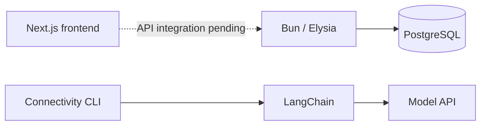

# ForCare

ForCare is a web application for hospitals and homecare providers to coordinate patient check-ins, nurse visits and care records.

The backend implements patient registration, cookie sessions, owned contact profiles, a synthetic nurse directory and primary-nurse patient scope in PostgreSQL. The Next.js frontend is being developed separately; API integration is pending. Booking, check-ins, clinical records, clinical scoring, AI analysis, notifications and browser push are not implemented yet. Health-related AI output will require human review.

## Run the backend and database

You need Docker Engine and Docker Compose v2 or later.

```sh
cp .env.example .env
# Set POSTGRES_PASSWORD and AUTH_SESSION_SECRET to unique secrets in .env.
# Set AUTH_ALLOWED_ORIGINS to the exact HTTPS frontend origin.
# Set AUTH_NURSE_EMAIL_DOMAIN=nurse.invalid for the synthetic nurses.
docker compose build backend
docker compose up -d --wait db
docker compose run --rm --no-deps backend bun run migrate
docker compose up -d --wait backend
curl --fail http://127.0.0.1:3001/health/ready
```

The backend listens on `127.0.0.1:3001`. Set `BACKEND_PORT` in `.env` if that port is occupied. PostgreSQL is available to containers at `db:5432`; it has no published host port.

Keep `.env` out of Git. Optional blank entries use the defaults in `compose.yaml`; the database password, allowed origins and session secret are required. `AUTH_SESSION_SECRET` must contain at least 32 characters. To validate without printing credentials, run `docker compose config --quiet`.

Run migrations explicitly after building the backend and before using account routes. The runner verifies previously applied checksums and does not seed users or erase data. Browser authentication requires an HTTPS frontend/proxy with an exact allowed origin. The loopback backend health URL above is not a browser-auth deployment. See the [implemented API reference](backend/API.md) and [backend setup](backend/README.md) for native testing and controlled identity operations.

```sh
docker compose ps
docker compose logs --tail 50 backend
docker compose down
```

`down` preserves the database volume. Removing the volume deletes its data. If the database has already been initialized, changing `POSTGRES_PASSWORD` in `.env` alone will not rotate its stored password.

## Run the frontend

```sh
cd frontend
npm ci
npm run dev
```

Open `http://localhost:3000`. The frontend is not included in Compose yet, and its API integration is pending. See [frontend/README.md](frontend/README.md) for its setup instructions.

## Check the backend

Bun 1.4.2 is used for the backend and pinned Docker image.

```sh
cd backend
bun install --frozen-lockfile
bun run typecheck
bun test
```

The LangChain tests use a synthetic local HTTP provider. They test the graph and transport without contacting a paid model service.

## Check a model connection

AI is disabled by default. To test a provider, set these values in the root `.env`:

- `AI_ENABLED=true`
- `AI_API_KEY`: your provider credential.
- `AI_MODEL`: a model available to your account.
- `AI_BASE_URL`: optional OpenAI-compatible Chat Completions endpoint. Leave it blank for OpenAI.
- `AI_TIMEOUT_MS`: optional request timeout, default `30000`.

```sh
docker compose up -d --wait backend
docker compose exec -T backend bun run ai:smoke
```

A successful call prints `FORCARE_LANGCHAIN_OK`. The check sends a fixed software-connectivity prompt, not patient data, and may incur a provider charge. It has no tools or database access. Startup and health checks do not call the model, and Compose disables LangChain tracing.

## Structure

- `frontend/`: Next.js application.
- `backend/`: Elysia API and LangChain setup. [Backend configuration](backend/README.md).
- `compose.yaml`: backend and PostgreSQL services.
- `.env.example`: environment variable names without secret values.



## Dependencies and AI use

- [Next.js](https://github.com/vercel/next.js), [React](https://github.com/facebook/react) and [Tailwind CSS](https://github.com/tailwindlabs/tailwindcss): MIT.
- [Elysia](https://github.com/elysiajs/elysia), [Bun](https://github.com/oven-sh/bun), [LangChain.js](https://github.com/langchain-ai/langchainjs) and [Zod](https://github.com/colinhacks/zod): MIT.
- [TypeScript](https://github.com/microsoft/TypeScript): Apache-2.0.
- [PostgreSQL](https://www.postgresql.org/about/licence/): PostgreSQL License.

OpenAI Codex (`gpt-6.1-sol`) and DeepSeek (`DeepSeek-V4.1-Flash-1017`) assisted with backend implementation, reviews, Docker configuration and tests. Application AI currently consists of the optional LangChain connectivity check through `@langchain/openai`; patient-analysis workflows and the production model have not been selected.
