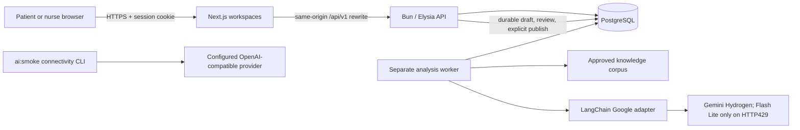

# ForCare

ForCare is a web application for hospitals and homecare providers to coordinate patient check-ins, homecare scheduling, and care records.

The Next.js frontend provides real cookie-backed patient and provisioned nurse workspaces through a same-origin API proxy. Patient registration, profile/contact editing, draft and submitted check-ins, active care guides, and published patient-facing analyses are implemented. Primary nurses can read their assigned patients' records, create and correct versioned medical snapshots, review cited AI drafts, and explicitly publish an approved revision. Review and publication are separate operations; recorded observations and nurse confirmations also remain separate.

Stop 4 adds real homecare scheduling. Nurses publish their own versioned availability; patients choose an eligible nurse and, for an ordinary booking, an actual available slot; patients save and submit screening drafts, inspect history, and cancel before the visit starts. The selected nurse reviews only the requests addressed to them, accepts or rejects them, sees confirmed visits, and can cancel or reschedule them with a reason and explicit patient agreement. A separate manual priority review can approve an exact outside-availability interval, but that approval neither submits nor accepts the booking.

An accepted booking creates a scheduling-only visit identity. It does not create a completed clinical record, reassign the patient's primary nurse, or grant access to the full chart. The selected nurse receives only the temporary intake or accepted-visit context needed for that booking, including the active patient-facing care guide during the visit grant; general chart access remains restricted to the primary-assignment rules. Booking and schedule authorization, backend conflicts, immutable history, and manual exception rules are specified in the [Stop 4 API reference](backend/API.md#bookings-and-selected-nurse-scheduling).

The Elysia API stores application data in PostgreSQL. A separate analysis worker uses the fixed approved knowledge corpus and Google AI Studio's `gemini-4-hydrogen`, with `gemini-3.5-flash-lite` attempted only after a numeric HTTP 429 response. Its durable nurse-review pause does not publish content automatically. Stop 4 booking and scheduling work without that worker or any model call; no paid-model verification is needed to exercise those workflows.

Numerical clinical scoring, visit clinical records/finalization, notifications and reminders, and browser push remain unavailable in Stop 5. The older mock-only frontend source is retained but is not the active product implementation.

## Run the backend and database

You need Docker Engine and Docker Compose v2 or later.

```sh
cp .env.example .env
# Set POSTGRES_PASSWORD and AUTH_SESSION_SECRET to unique secrets in .env.
# Set AUTH_ALLOWED_ORIGINS to the exact HTTPS frontend origin.
# Set AUTH_NURSE_EMAIL_DOMAIN=nurse.invalid for the synthetic nurses.
docker compose build backend
docker compose up -d --wait db
docker compose run --rm --no-deps backend bun run migrate
docker compose up -d --wait backend
curl --fail http://127.0.0.1:3001/health/ready
```

The backend listens on `127.0.0.1:3001`. Set `BACKEND_PORT` in `.env` if that port is occupied. PostgreSQL is available to containers at `db:5432`; it has no published host port. Compose currently provides only the API and database; start Next.js and the analysis worker separately as described below.

Keep `.env` out of Git. Optional blank entries use the defaults in `compose.yaml`; the database password, allowed origins and session secret are required. `AUTH_SESSION_SECRET` must contain at least 32 characters. To validate without printing credentials, run `docker compose config --quiet`.

Run migrations explicitly after building the backend and before using account, availability, or booking routes. The runner verifies previously applied checksums and does not seed users, availability, operating hours, or erase data. Production browser authentication requires an HTTPS frontend with an exact allowed origin. The loopback backend health URL above is not a browser-auth deployment. See [backend database setup](backend/README.md#database-migrations-and-integration-tests) for migration behavior and [Stop 4 scheduling configuration](backend/API.md#bookings-and-selected-nurse-scheduling) for the scheduling contract.

Native loopback HTTP testing is a separate, narrow path: explicitly enable `AUTH_LOCAL_HTTP_TEST=true` and start the API with `HOST=127.0.0.1`. Only exact loopback HTTP origins are accepted, and the `Secure` `__Host-` session-cookie attributes remain unchanged. A native API client must manage that cookie explicitly; this does not refer to a bundled authenticated smoke-client script. The existing Next.js same-origin rewrite also provides a localhost browser path for Chromium: default to frontend `http://localhost:3000` and API `127.0.0.1:3001`. If using frontend port `3400`, set `AUTH_ALLOWED_ORIGINS=http://localhost:3400` exactly. This is not a guarantee for arbitrary hosts, browsers, or HTTP deployments, and production HTTPS is unchanged. See the [reproducible native localhost demo](backend/README.md#reproducible-native-localhost-demo) and [implemented API reference](backend/API.md).

```sh
docker compose ps
docker compose logs --tail 50 backend
docker compose down
```

`down` preserves the database volume. Removing the volume deletes its data. If the database has already been initialized, changing `POSTGRES_PASSWORD` in `.env` alone will not rotate its stored password.

## Run the frontend and analysis worker

The frontend and analysis worker are separate processes and are not included in Compose. Use frontend `http://localhost:3000` and API `127.0.0.1:3001` consistently. For the isolated native localhost reproduction—including Bun 1.4.2, the disposable PostgreSQL 16 container on `127.0.0.1:55432`, migrations, private environment, worker key, operator steps, and scoped cleanup—follow [backend setup](backend/README.md#reproducible-native-localhost-demo).

Independently of that native procedure, the frontend can be started from `frontend/` with `npm ci` and `npm run dev`. `FORCARE_BACKEND_ORIGIN` defaults to `http://127.0.0.1:3001`. Next.js rewrites only same-origin `/api/v1/:path*` requests to that origin and does not expose backend credentials to browser code. Set a changed API origin before starting Next.js; for a production server it is used during `npm run build`, so changing the API port requires a rebuild. The worker requires its own private `GOOGLE_API_KEY` and the same PostgreSQL configuration. The `ai:smoke` CLI below is only a non-medical provider-connectivity check, not this clinical draft worker.

Browser production still requires HTTPS and exact allowed origins. The native loopback browser path is qualified only for Chromium on localhost, not general browser or Compose behavior. See [frontend/README.md](frontend/README.md) for routes and production scripts, and [backend setup](backend/README.md#reproducible-native-localhost-demo) for the native procedure, worker, and environment details.

## Check the backend

Bun 1.4.2 is used for the backend and pinned Docker image.

```sh
cd backend
bun install --frozen-lockfile
bun run typecheck
bun test
```

The LangChain tests use a synthetic local HTTP provider. They test the graph and transport without contacting a paid model service.

## Check a model connection

AI is disabled by default. To test a provider, set these values in the root `.env`:

- `AI_ENABLED=true`
- `AI_API_KEY`: your provider credential.
- `AI_MODEL`: a model available to your account.
- `AI_BASE_URL`: optional OpenAI-compatible Chat Completions endpoint. Leave it blank for OpenAI.
- `AI_TIMEOUT_MS`: optional request timeout, default `30000`.

```sh
docker compose up -d --wait backend
docker compose exec -T backend bun run ai:smoke
```

A successful call prints `FORCARE_LANGCHAIN_OK`. The check sends a fixed software-connectivity prompt, not patient data, and may incur a provider charge. It has no tools or database access. Startup and health checks do not call the model, and Compose disables LangChain tracing.

## Rehearse a synthetic local demo

Use only synthetic data in an isolated, project-owned database. This is a rehearsal guide, not a claim that every full-stack step has been verified end to end, that a public demo is deployed, or that final submission is complete. Homecare booking needs the API, migrated database, and frontend, but not the analysis worker or a paid model. Only the optional clinical-analysis portion needs your own `GOOGLE_API_KEY` and may incur provider charges.

1. Follow the [native localhost demo](backend/README.md#reproducible-native-localhost-demo) for a disposable rehearsal database, migrations, private settings, and frontend/API defaults. That browser path is qualified for Chromium on localhost only. For any production browser deployment, terminate HTTPS at the Next.js origin and configure that exact allowed origin; never disable `Secure` cookies or generalize this loopback setting to arbitrary hosts or browsers.
2. Open `/daftar` and register a synthetic patient (public registration is patient-only). Sign in at `/login`, edit contact details at `/pasien/profil/kontak`, then create a check-in at `/pasien/check-in`. Save its draft, correct it, and explicitly submit it.
3. Using the controlled CLI operations in [backend setup](backend/README.md), run `seed:demo` with the approved `nurse.invalid` domain to provision the three synthetic nurses, then use `patient:assign record` and `patient:assign primary` for the patient record number and primary-nurse assignment. Keep generated credentials private; there are no shared demo passwords in this repository.
4. Sign in as that primary nurse and open the assigned patient through `/pasien-rekam-medis`. Create the full medical source snapshot, then save a separate immutable correction and reload to inspect its revision.
5. As each nurse whose calendar you will use, open `/jadwal-kunjungan`, select **Atur ketersediaan**, and publish availability from the explicit settings, weekly windows, and timestamped UTC slots. Use synthetic times such as Monday–Friday 09:00–17:00 in `Asia/Jakarta`, 60-minute slots, and zero buffer only as a deliberately entered demo configuration; there are no built-in production hours, default time zone, or generated slots. A later availability version changes future unaccepted eligibility without rewriting an accepted visit.
6. Return to the patient account. At `/pasien/homecare/pesan`, choose the real nurse and one listed slot, complete the screening including explicit consent, and save/reopen the draft. Submit it separately, then use `/pasien/homecare` to distinguish the submitted request from an accepted visit and inspect its history. If the nurse rejects it, read the supplied reason rather than treating the request as scheduled.
7. Sign in as the selected nurse and review the request through `/pengajuan-homecare` and `/pengajuan-homecare/[requestId]`. Accept one submission to create its confirmed visit; a competing request on the same reserved interval remains only a request and should produce the documented schedule conflict on acceptance. Inspect the confirmed interval at `/jadwal-kunjungan`. Before the old and proposed new start times, cancel with a reason or reschedule to another current slot with a reason and explicit patient agreement; these actions retain the selected nurse and scheduling identity. Use the patient history to confirm the resulting status.
8. Rehearse the manual exception separately: create another patient draft with an exact outside-hours UTC interval, submit the priority statement, and have the selected nurse explicitly review availability. Availability approval still does not submit or accept the booking. Return as the patient to submit that exact booking, then as the same nurse to accept it in a distinct booking-decision action. An unavailable/declined review or any changed interval must not be presented as an approved reservation. The API's cap and overlap checks still apply; priority is neither clinical scoring nor an AI/emergency bypass.
9. For the independent AI workflow, start the separate analysis worker and prepare the fixed bundled corpus using the exact import and operator-attested synthetic approval procedure in [corpus setup](backend/src/knowledge/README.md). Generate a cited draft from the submitted check-in. Review or revise it as the primary nurse and explicitly approve the chosen revision; approval is not publication.
10. After the worker reconciles the durable review gate, use the separate publish action. Return to the patient workspace and open `/pasien/panduan` to inspect only the published patient-facing projection, never the internal note or raw medical snapshot. Log out from the workspace to end that cookie-backed session.

The Stop 5 `/jadwal-kunjungan/[visitId]` clinical record, visit completion/finalization, numerical scoring, notifications/reminders, and browser push remain unavailable; do not substitute mock screens for them. Compose does not start the frontend or worker, so this is intentionally not a one-command full-stack procedure. Cleanup must target only the demo container selected in the backend procedure; the disposable database, generated credentials, and private environment files are discarded afterward, leaving no ready public accounts.

## Structure

- `frontend/`: Next.js patient and nurse workspaces, cookie-backed sessions, and same-origin API proxy.
- `backend/`: Elysia API, separate durable analysis worker, and PostgreSQL schema. [Backend configuration](backend/README.md).
- `backend/src/knowledge/`: fixed approved retrieval corpus and its operator-attested importer. [Corpus setup](backend/src/knowledge/README.md).
- `compose.yaml`: API and PostgreSQL services only.
- `.env.example`: environment variable names without secret values.



## Dependencies and AI use

- [Next.js](https://github.com/vercel/next.js), [React](https://github.com/facebook/react) and [Tailwind CSS](https://github.com/tailwindlabs/tailwindcss): MIT.
- [Elysia](https://github.com/elysiajs/elysia), [Bun](https://github.com/oven-sh/bun), [LangChain.js](https://github.com/langchain-ai/langchainjs) and [Zod](https://github.com/colinhacks/zod): MIT.
- [TypeScript](https://github.com/microsoft/TypeScript): Apache-2.0.
- [PostgreSQL](https://www.postgresql.org/about/licence/): PostgreSQL License.

OpenAI Codex (`gpt-6.1-sol`) and DeepSeek (`DeepSeek-V4.1-Flash-1017`) assisted with backend implementation, reviews, Docker configuration and tests. The now-implemented analysis workflow produces cited nurse-review drafts through LangChain's Google AI Studio transport. It uses `gemini-4-hydrogen` and falls back to `gemini-3.5-flash-lite` only for a numeric HTTP 429. The independent `ai:smoke` command still uses its separately configured OpenAI-compatible provider and never runs clinical analysis.
